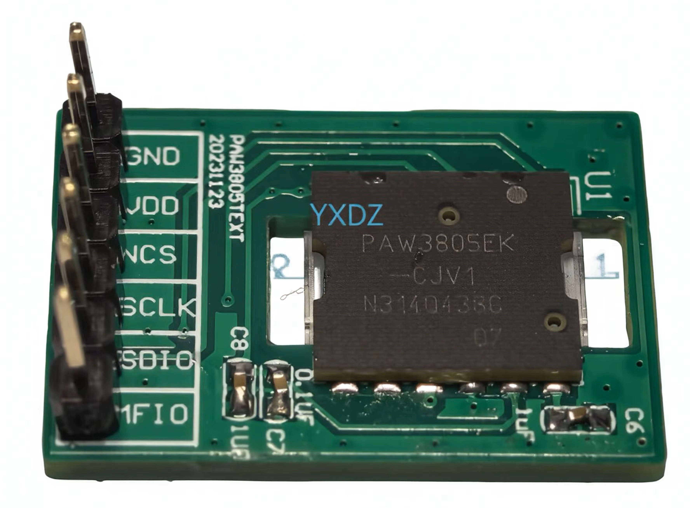
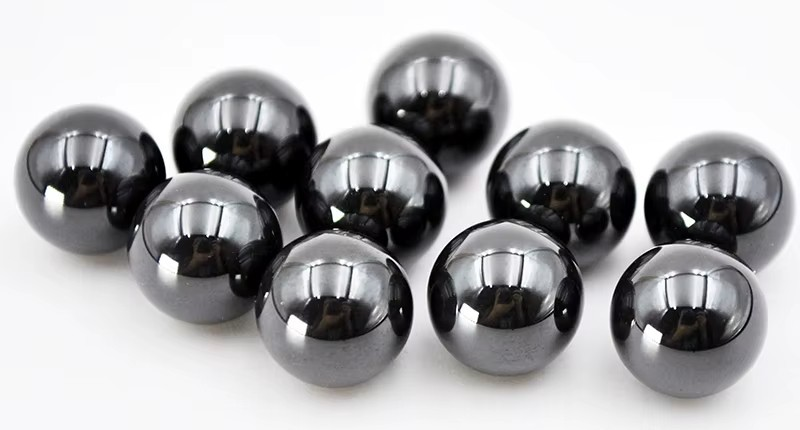

## IAS Sensor Board (PAW3805ek-cjv1 x2)

| Item | Length/ from left (mm) | Width/ from bottom (mm) |
|-|-|-|
| Sensor board | 24.48 | 16.74 |
| Sensor | 10.70 | 9.80 |
| Sensor on board | 10.70 | 3.65 |
| Focal center on chip | 5.20 | 4.90 |
| Focal center on board | 15.90 | 8.55 |

## Optical Encoder (x2)

- Dual channel quadrature encoder consists of two individual optical interrupters
- VCC: 3.3-5V; D0: output.  A0 is no use.

## MCU Board (ESP32-S2 Mini)

## Ball Bearing (3 mm Si3N4 x3)

## Scroll Ring Bearing (1x3 mm PTFE Tube)

