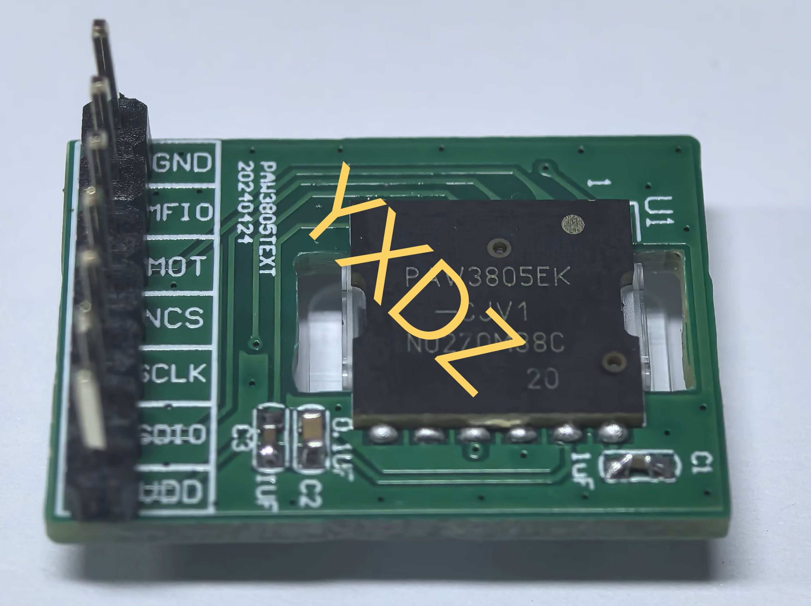
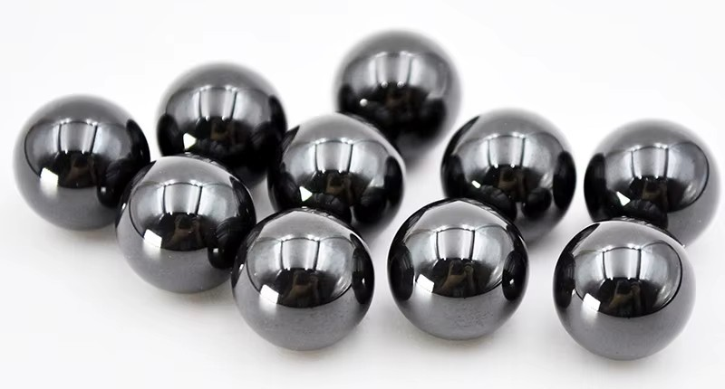
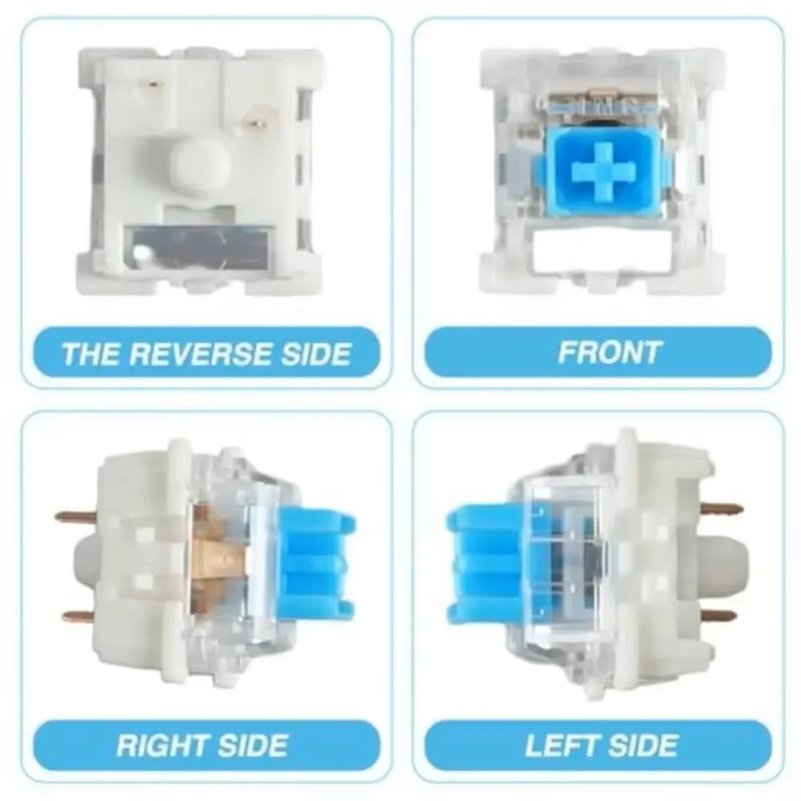

## IAS Sensor Board (PAW3805ek-cjv1 x2)

| Item | Length/ from left (mm) | Width/ from bottom (mm) |
|-|-|-|
| Sensor board | 24.70 | 17.30 |
| Sensor | 10.70 | 9.80 |
| Sensor on board | 11.00 (3.00 on right) | 3.75 (3.75 on top) |
| Focal center on chip | 5.70 | 4.90 |
| Focal center on board | 16.70 | 8.65 |
| Lens lip | 14 | 9 |
| Lens neck | 11.5 | 6 |

## Optical Encoder (x2)

- Dual channel quadrature encoder consists of two individual optical interrupters
- VCC: 3.3-5V; D0: output.  A0 is no use.

## MCU Board (ESP32-S2 Mini)

## Ball Bearing (3 mm Si3N4 x3)

## Scroll Ring Bearing (1x3 mm PTFE Tube)

## Ball (57.2mm Billiard Cue Ball)

## Button Socket (MX Hot-Swappable Socket x4)

## Button Switch (MX Keyboard Switch x4)

## Nut Insert (M4 OD: 5mm Length: 3mm x5)

## Screw (M4x6mm x5)

<!--
## xx

## xx

## xx

-->
